<a href="https://asafarusi.co.il">
  
</a>

<p align="center">
  <b>AI Software Engineer @ Dig AI</b>, and the only engineer there.<br/>
  I build products end to end: UI, API, database, and the AI on top. Idea to prod, same day.
</p>

<p align="center">
  <a href="https://asafarusi.co.il"></a>
  <a href="https://www.linkedin.com/in/asafarusi"></a>
  <a href="mailto:asafarusi2@gmail.com"></a>
</p>

---

```yaml
player:     Asaf Arusi
class:      AI Software Engineer
guild:      Dig AI                   # party size: 1. frontend, backend, infra, AI. all of it.
training:   BSc Computer Science · HIT
specialty:  full stack + AI          # git blame is a very short conversation
base:       Giv'at Shmuel, IL

stats:
  code:     ██████████████████░░  92
  debug:    ███████████████████░  97   # reads stack traces recreationally
  ship:     ███████████████████░  95
  chaos:    ████████████████████ 100   # controlled. mostly.

inventory:  [🎮 controller, ⚽ football, 🎧 headphones]
status:     sanity check FAILED → continuing anyway
```

### ⚡ Loadout

<p>
  
  
  
  
  
  
  
  
  
  
</p>

### 🕹️ Current quest

- [x] Architect the platform from zero
- [x] Ship the portal to real users
- [x] Wire AI into the product, not just the pitch deck
- [x] Be the entire engineering department
- [ ] Sleep 8 hours

### 🐍 Contribution boss fight

<picture>
  <source media="(prefers-color-scheme: dark)" srcset="https://raw.githubusercontent.com/asafarusi/asafarusi/output/snake-dark.svg" />
  <source media="(prefers-color-scheme: light)" srcset="https://raw.githubusercontent.com/asafarusi/asafarusi/output/snake.svg" />
  
</picture>

<p align="center"><sub>↑ ↑ ↓ ↓ ← → ← → B A, and try it on the <a href="https://asafarusi.co.il">site</a>.</sub></p>
