<a href="https://asafarusi.co.il">
  <picture>
    <source media="(prefers-color-scheme: dark)" srcset="./assets/header-dark.svg" />
    <source media="(prefers-color-scheme: light)" srcset="./assets/header-light.svg" />
    
  </picture>
</a>

 

<picture>
  <source media="(prefers-color-scheme: dark)" srcset="./assets/statement-dark.svg" />
  <source media="(prefers-color-scheme: light)" srcset="./assets/statement-light.svg" />
  
</picture>

Right now I'm building at Dig AI, working across the whole product: the interface, the backend, the infrastructure and the AI features that run through it.

<picture>
  <source media="(prefers-color-scheme: dark)" srcset="./assets/stack-dark.svg" />
  <source media="(prefers-color-scheme: light)" srcset="./assets/stack-light.svg" />
  
</picture>

 

<a href="https://asafarusi.co.il">
  <picture>
    <source media="(prefers-color-scheme: dark)" srcset="./assets/contact-dark.svg" />
    <source media="(prefers-color-scheme: light)" srcset="./assets/contact-light.svg" />
    
  </picture>
</a>

  <a href="https://asafarusi.co.il">asafarusi.co.il</a> &nbsp;·&nbsp; <a href="https://www.linkedin.com/in/asafarusi">LinkedIn</a> &nbsp;·&nbsp; <a href="mailto:asafarusi2@gmail.com">Email</a>

